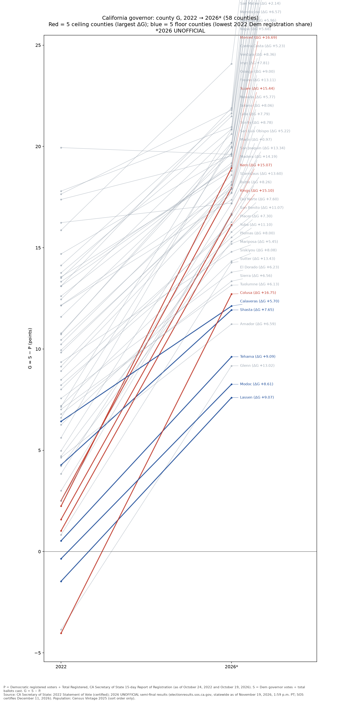
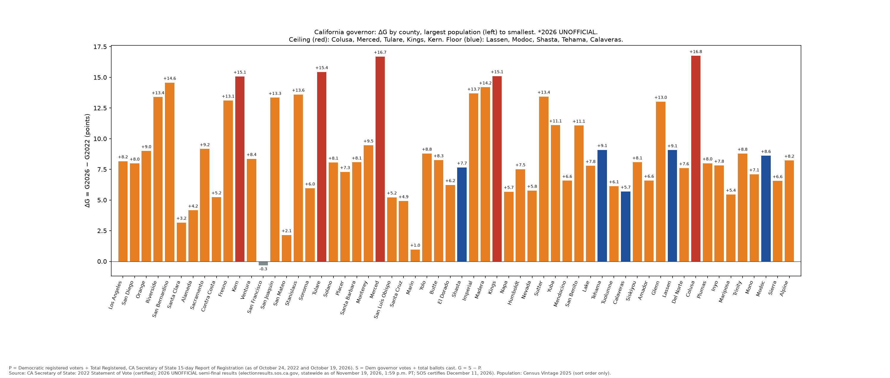
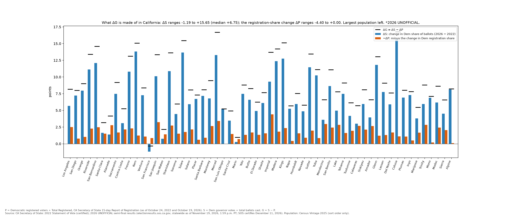
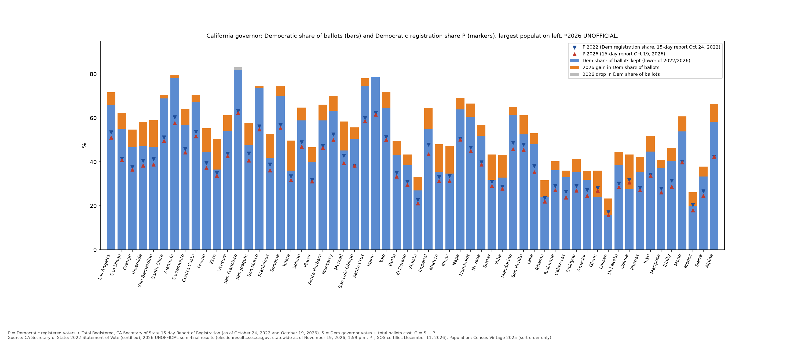
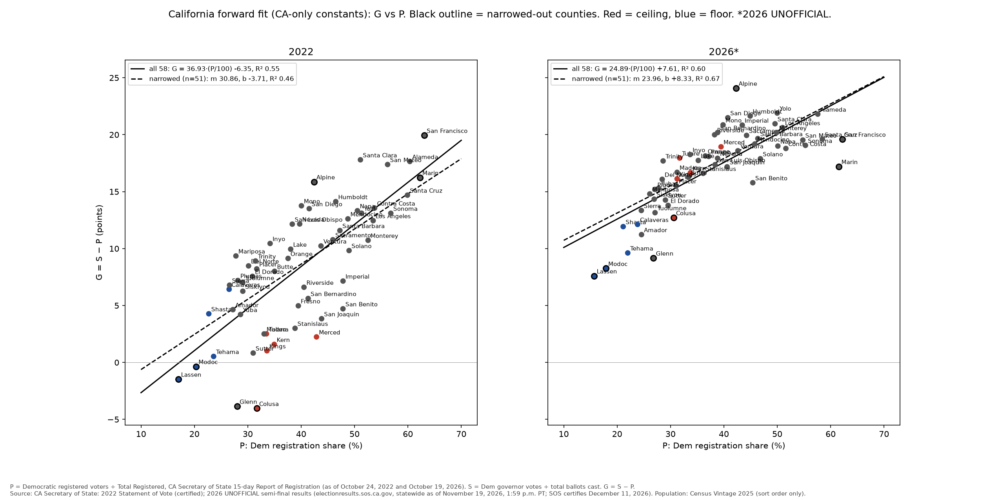
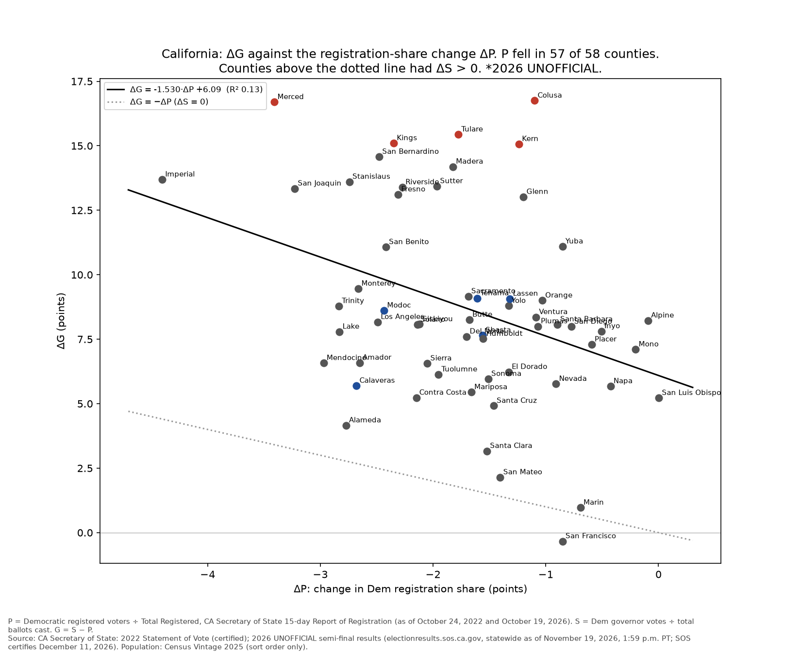
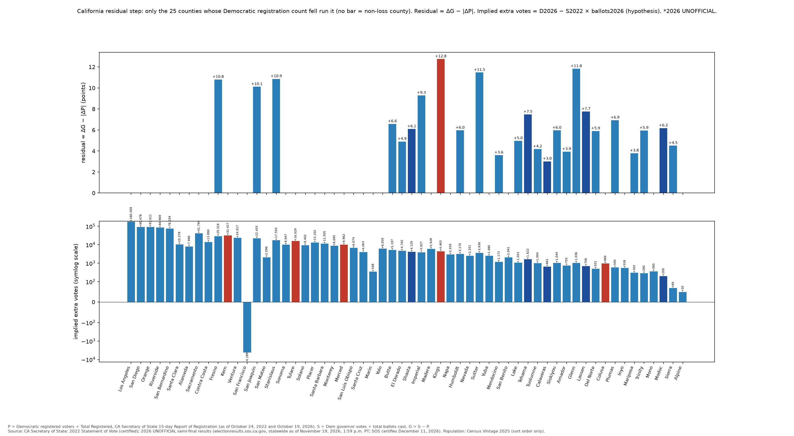
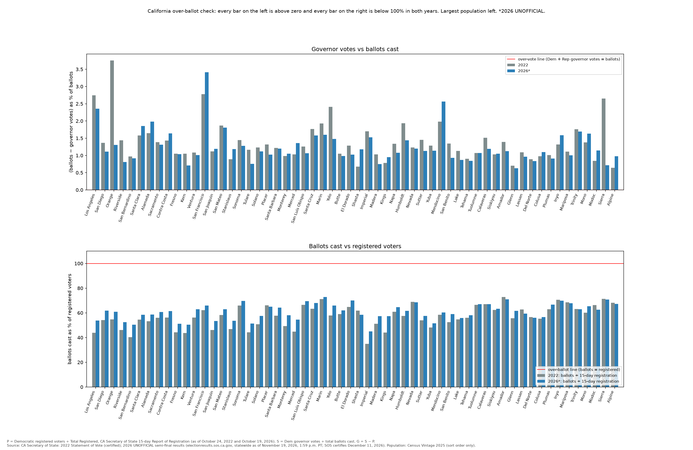

> **\*2026 figures are UNOFFICIAL.** The California Secretary of State (SOS) results site, electionresults.sos.ca.gov, labels the November 3, 2026 general election results "Unofficial" (semi-final unofficial results with county updates; statewide figures as of November 19, 2026, 1:59 p.m. Pacific; pulled November 19, 2026). Counties are still in the canvass: the SOS Unprocessed Ballots Report (as of 11/18/2026 5:33 p.m.) estimated 100,313 ballots statewide still to process, plus 96,238 ballots left to cure. Counties must report final official results by December 4, 2026, and the SOS certifies on December 11, 2026, so these pages need a re-run after certification. 2022 figures are the certified Statement of Vote (certificate dated the 16th day of December, 2022). **P** = Democratic share of registered voters in the SOS 15-day Report of Registration (close of registration: as of October 24, 2022 and as of October 19, 2026). Governor race only. Votes are votes for the Democratic candidate, not a count of registered Democrats who voted. These pages measure a pattern; they make no claim about intent, fraud or cause.

Every chart carries the source and the 2026 UNOFFICIAL label in its footer. Bars run left to right from the largest county to the smallest (Census Vintage 2025).

## Slope chart: G, 2022 to 2026

*Each line is one county. Red lines are the ceiling counties, blue lines the floor counties.*

## ΔG by county, population order

*Largest county on the left. Red = ceiling, blue = floor.*

## What ΔG is made of: ΔS vs ΔP

*Blue = change in the Democratic share of ballots; orange = minus the change in the Democratic registration share; black tick = ΔG.*

## Democratic share of ballots and P, population order

*Bars: the Democratic share of ballots, with the 2026 gain stacked on top. Markers: P in each year.*

## Forward fit: CA-only constants

*Solid line: all-county fit. Dashed: narrowed fit. Black outline = narrowed-out county.*

## ΔG vs ΔP

*Counties above the dotted line had a rise in S.*

## Residual step and implied extra votes

*Top: residual = ΔG − |ΔP| for loss counties only. Bottom: implied extra votes (symmetric log scale).*

## Over-ballot check

*Top: ballots minus governor votes, as a share of ballots. Bottom: ballots as a share of 15-day registration. No county crosses either line.*

## Data behind the charts

- County table: [data/CA_Governor_2022_2026_DeltaG_by_County.csv](https://github.com/mbenson8989/California-Election-Analysis/blob/main/data/CA_Governor_2022_2026_DeltaG_by_County.csv)
- Fits, narrowed fits, floor and ceiling, over-ballot checks: [data/CA_results_summary.json](https://github.com/mbenson8989/California-Election-Analysis/blob/main/data/CA_results_summary.json)
- Verification (both passes, figure by figure): [verification/](https://github.com/mbenson8989/California-Election-Analysis/tree/main/verification)

---
**Related:** [Home](Home) · [Bottom-Up Reverse Math](Reverse-Math) · [Locked California Formula](Locked-California-Formula) · [Floor and Ceiling Counties](Floor-and-Ceiling) · [California County PDF Information](California-County-PDF-Information) · [Cedar County Audit (Nebraska)](https://github.com/mbenson8989/Nebraska-Election-Analysis-/wiki/Cedar-Audit)
